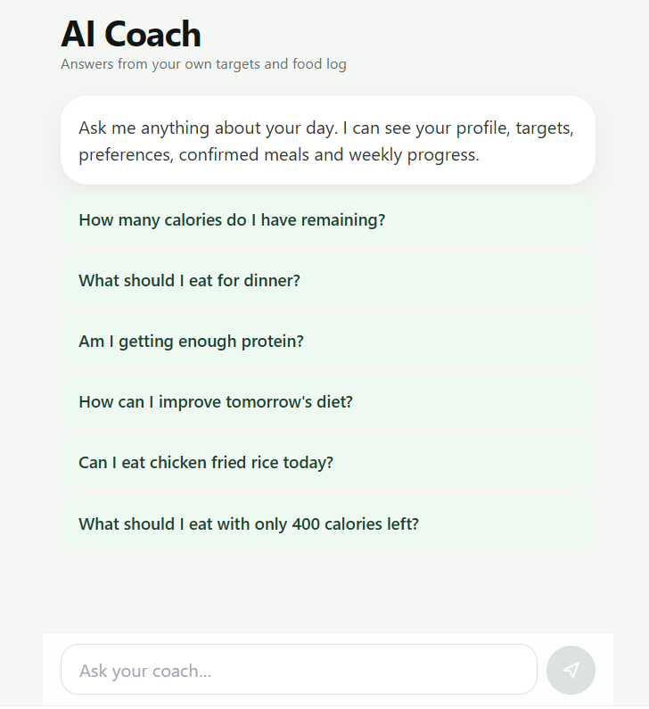

# NutriTrack AI

Personal AI nutrition and fat-loss assistant. An installable iPhone web app (PWA): meal reminders by push
notification, photo-based food recognition with a confirm-and-correct step, manual logging, water and weight
tracking, an AI coach that reads your own records, a nightly AI report, weekly analytics, and an optional
equipment-free home workout module.

**Stack:** React + TypeScript + Tailwind (Vite PWA) · Supabase (Postgres, Auth, Storage, Edge Functions, pg_cron) ·
Google Gemini vision/LLM (Claude also supported) · Web Push (VAPID) · Recharts.


## Screenshots

<table>
<tr>
<td width="33%"></td>
<td width="33%"></td>
<td width="33%"></td>
</tr>
<tr>
<td align="center"><sub>Sign in</sub></td>
<td align="center"><sub>Daily dashboard</sub></td>
<td align="center"><sub>AI coach</sub></td>
</tr>
</table>

---

## Setup (about 30 minutes, once)

You need a computer with [Node 20.19+](https://nodejs.org) for these steps. Afterwards everything runs from your iPhone.

### 1. Create the accounts and keys

| What | Where | You get |
|---|---|---|
| Supabase project (free tier is enough) | supabase.com → New project | Project URL, anon/publishable key, project ref |
| Gemini API key | aistudio.google.com → Get API key | `GEMINI_API_KEY` |
| VAPID keys for push | run `npm install && npm run vapid` in this folder | public + private key |
| Cron secret | invent a long random string | `CRON_SECRET` |
| USDA key (optional, for online food search) | fdc.nal.usda.gov/api-key-signup | `FDC_API_KEY` |

### 2. Create the database

Supabase dashboard → **SQL Editor** → run these files in order (paste the whole file, press Run):

1. `supabase/migrations/0001_schema.sql` — tables, Row Level Security, private photo bucket
2. `supabase/migrations/0002_seed_foods.sql` — built-in reference foods

Optional but convenient for a single-user app: **Authentication → Sign In / Providers → Email → turn off "Confirm email"**,
so you can sign in immediately after creating your account. Once your account exists you can also turn off
"Allow new users to sign up" so nobody else can register.

### 3. Deploy the backend functions

No command line? Deploy both functions from the Supabase dashboard instead
(**Edge Functions → Deploy a new function → Via Editor**), pasting the single-file
builds in [`deploy/`](deploy/). Set the secrets below under **Edge Functions → Secrets**.
Otherwise, with the CLI:

```bash
npx supabase login
npx supabase link --project-ref YOUR-PROJECT-REF

npx supabase secrets set \
  GEMINI_API_KEY=your-gemini-key \
  VAPID_PUBLIC_KEY=... \
  VAPID_PRIVATE_KEY=... \
  VAPID_SUBJECT=mailto:you@example.com \
  CRON_SECRET=your-long-random-string
# optional: FDC_API_KEY=...   AI_MODEL=gemini-3.8-flash (default; any vision-capable Gemini model id works)
# To use Claude instead, set ANTHROPIC_API_KEY and leave GEMINI_API_KEY unset.

npx supabase functions deploy api
npx supabase functions deploy tick --no-verify-jwt
```

These secrets live only on Supabase. No AI key is ever shipped to the browser.

### 4. Turn on the reminder scheduler

Open `supabase/migrations/0003_cron.sql`, replace `YOUR-PROJECT-REF` and `YOUR-CRON-SECRET`, and run it in the SQL Editor.
It calls the `tick` function once a minute. (If the editor says pg_cron or pg_net is unavailable, enable both under
**Database → Extensions** first.)

### 5. Deploy the app

```bash
cp .env.example .env      # fill in the three values
npm run build             # type-checks and builds into dist/
```

Then publish the `dist` folder to any static HTTPS host:

- **Netlify (easiest):** drag the `dist` folder onto app.netlify.com/drop.
- **Vercel:** `npx vercel dist --prod`.
- Or connect a Git repo to either host: build command `npm run build`, output `dist`, and add the three `VITE_…`
  variables in the host's environment settings.

### 6. Install on your iPhone

1. Open your app's HTTPS address in **Safari**.
2. Tap **Share** → **Add to Home Screen** → **Add**.
3. Open **NutriTrack** from the new Home Screen icon (this matters: push only works from the installed app).
4. Create your account, complete onboarding (confirm sex, age, targets).
5. **Profile → Notifications → Enable notifications** → Allow. Tap **Send a test**.

No App Store is involved. The app has its own icon, name and full-screen launch.

---

## How notifications work, and iOS limits

- Reminders are **real Web Push notifications** sent by the server, so they arrive when the app is closed and the phone is locked.
  The `tick` function runs every minute, compares each reminder with your phone's timezone, and pushes the ones that are due.
- **Requirements on iPhone:** iOS 16.4 or later; the app must be added to the Home Screen from Safari; permission must be
  granted by tapping the button inside the installed app.
- **Snooze / Completed / Skipped:** tapping a reminder opens a screen with *Log now*, *Snooze 10 min*, *Snooze 15 min*,
  *Mark as completed* and *Mark as skipped*. Snooze is handled by the server, which re-sends the reminder on time. The
  notification also carries Snooze action buttons, but iOS does not reliably show action buttons for web apps, so the
  in-app screen is the dependable route.
- A meal reminder is not sent if that meal is already logged or marked skipped.
- Delivery timing is up to about a minute after the scheduled time. Focus modes and Low Power Mode can delay or silence notifications.
- iOS can drop a push subscription if the app is unused for a long time; the app re-registers every time you open it.
  Deleting the Home Screen icon deletes the app's local data (your synced data stays in Supabase).
- 9:30 PM review: the server writes the daily report first, then notifies you. On Sundays it also writes the weekly report.

## Accuracy and data sources

- A photo cannot give exact weights or calories. Every AI value is labelled **AI estimate** with a confidence level;
  unclear portions are flagged and ask for grams, S/M/L, or confirmation; hidden oil and sauces are asked about.
- Nothing counts until you press **Confirm and save**. Confirmed items are the only source for totals, reports and the coach.
- Built-in foods (86) are labelled **Reference** (rounded standard values for the plain food, USDA FoodData Central)
  or **Typical recipe** (mixed dishes such as curries and biryani, where real recipes vary). These were entered by hand
  from standard figures and sanity-tested for internal consistency; spot-check the ones you eat most against a label.
  The **Search USDA database online** button pulls live values from the USDA API.
- Calorie targets are calculated with the Mifflin-St Jeor equation and shown with their assumptions. Targets below
  1,500 kcal (men) / 1,200 kcal (women), or well below resting needs, cannot be saved unless you confirm a professional approved them.
- Workout calories are MET-based estimates, displayed separately and never added to or subtracted from food.

## Offline

All screens read and write a local database on the phone. Meals (including photos), water, weight and workouts can be
logged with no connection and sync automatically when you are back online. AI features (photo analysis, coach, reports) need a connection.

## Security and backups

- Row Level Security on every table: a user can only read or write rows where `user_id` is their own id.
- Photos are in a private storage bucket, in a folder named after your user id, readable only by you.
- AI, VAPID private and cron keys are Supabase function secrets. The browser only holds the anon key, which is safe to expose under RLS.
- Backups: Supabase Pro includes daily backups; on the free tier use **Profile → Export my data** periodically, or
  `npx supabase db dump -f backup.sql`. Free-tier projects pause after about a week without activity; the every-minute scheduler keeps yours active.

## Running costs

Supabase free tier covers one user. AI usage runs on your Gemini API key: roughly one vision call per meal photo plus a few short
text calls per day. Check your key's free-tier limits and billing in Google AI Studio.

## Development

```bash
npm run dev        # local dev server
npm test           # unit tests: energy maths, food maths, dates, weight trend, workout generator, Web Push crypto
npm run build      # type-check + production build
npm run seed:sql   # regenerate 0002_seed_foods.sql after editing src/lib/foods.ts
```

### What was tested before handover

- Unit tests (18) pass, including a round-trip that decrypts the Web Push payload the server produces and verifies the VAPID signature.
- The production build was driven end to end in headless Chrome at iPhone size against an in-memory stand-in for
  Supabase: sign-in, onboarding and the restrictive-target block, photo → AI proposal → edit → confirm, dashboard totals,
  photo journal, manual logging, daily and weekly reports, coach, reminders and snooze, a workout session, and
  offline logging followed by automatic sync.
- **Not testable without your accounts:** the live Supabase project, real Gemini responses (the request/response adapter is unit-tested, but no live call was made), and actual push delivery
  to an iPhone. After setup, use *Send a test* and log one meal to confirm each of these.

## Project map

```
src/pages/            Home, Food Log + photo journal, meal flow, Analytics, Report, AI Coach, Profile, reminder screen
src/workouts/         Optional module: library (22 exercises, animated figures), generator, session, logging
src/lib/              db.ts (offline store + sync), nutrition.ts, foods.ts, analytics.ts, push.ts, actions.ts
src/sw.ts             Service worker: offline app shell, push, notification taps
supabase/migrations/  Schema + RLS, food seed, scheduler
supabase/functions/   api (AI vision, coach, reports, USDA search, test push) · tick (reminder scheduler) · _shared
```

NutriTrack AI gives estimates and general guidance. It is not a medical device and does not replace a doctor or dietitian.
