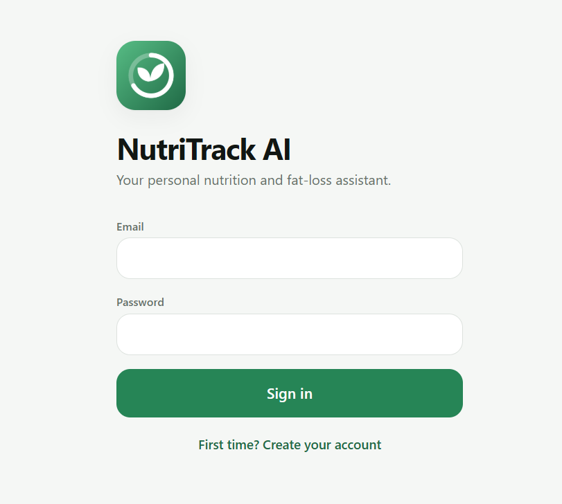
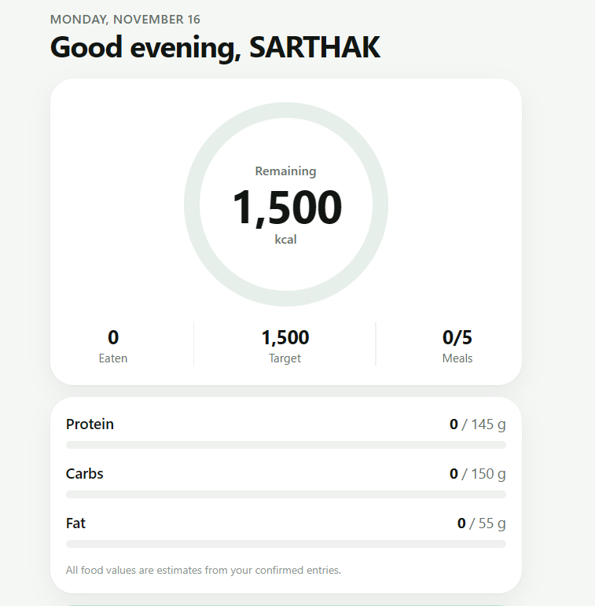
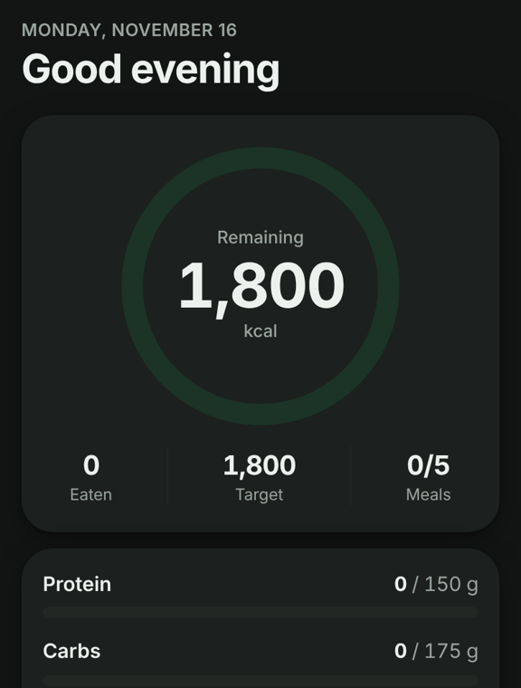
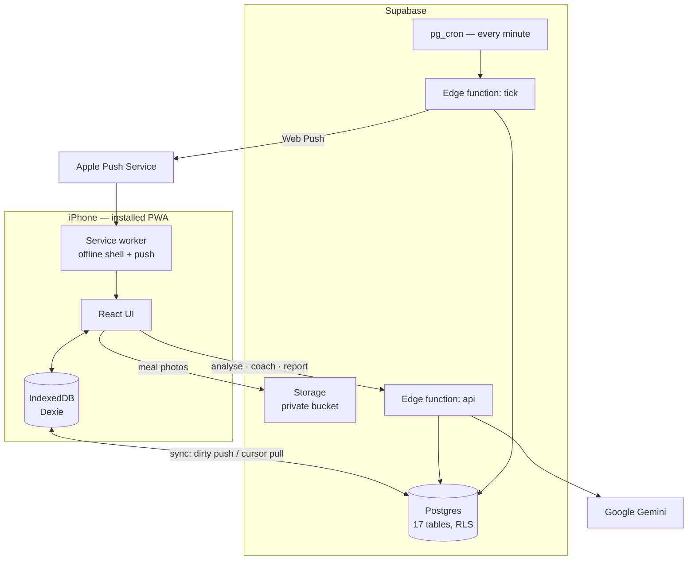

# NutriTrack AI

A personal AI nutrition and fat-loss assistant, built as an installable iPhone web app. Photograph a
meal, let a vision model identify and portion it, correct what it got wrong, and get push reminders,
a nightly AI report and weekly analytics built from your own confirmed records.

Built end to end from a written specification — see [How this was built](#how-this-was-built).

<table>
<tr>
<td width="33%"></td>
<td width="33%"></td>
<td width="33%"></td>
</tr>
<tr>
<td align="center"><sub>Sign in</sub></td>
<td align="center"><sub>Daily dashboard</sub></td>
<td align="center"><sub>Dark mode</sub></td>
</tr>
</table>

---

## What it does

**Logging**
- Photograph a meal; a vision model identifies each food, estimates portions, and flags what it could not judge
- Every estimate is editable before it counts — quantities, nutrition, cooking method, missing items
- Each photo is analysed twice; where the two passes disagree the item is flagged, so attention goes where it is needed
- Asks about hidden cooking oil, dressings and sauces when they would materially change the numbers
- Scan the nutrition panel on packaged food: values are read, normalised to per 100 g, and saved as a reusable food
- Manual logging from an 86-item reference database (Indian and common household foods) with live USDA lookup
- Water, daily weight, favourites, meal duplication, and a photo journal of every day
- A logging streak, and a weekly summary you can share as a single image
- An accuracy page comparing what the AI proposed against what you confirmed, per food

**Guidance**
- Daily push reminders (hydration, meals, nightly review) plus a weekly weigh-in, each snoozable or skippable
- An AI coach that answers from your actual targets, preferences and food log rather than generic advice
- A nightly report: ten specific questions answered, plus three concrete actions for tomorrow
- Weekly analytics — trends, meal consistency, reminder completion, and a 7-day weight average

**Throughout**
- Light and dark themes, following the system by default
- Metric or imperial units for weight and water; food is always counted in grams

**Optional**
- An equipment-free home workout module: 22 illustrated exercises, a routine generator, guided sessions
- Entirely optional by design. Nutrition tracking is unaffected if it is never opened

---

## How this was built

The application was produced from a specification rather than written by hand. The spec —
[`docs/PROMPT.md`](docs/PROMPT.md), with [`docs/PROMPT-workout-module.md`](docs/PROMPT-workout-module.md)
as a follow-up — was written first and defines the product, the personal profile, the data model, the
accuracy and safety rules, the stack and the build order. An AI coding agent implemented it, and each
stage was checked back against the spec. Commits are co-authored accordingly.

What made the specification work, rather than producing the usual non-functional mockup:

| Technique | In practice |
|---|---|
| **Constraints, not wishes** | "Do not pretend that a photograph provides exact food weights or calories." "Never invent precise nutritional information." These became the confidence labels and source badges in the UI. |
| **Define the edges** | "If I have not logged a meal, do not assume I skipped it. Mark it as unlogged." Unlogged, skipped and logged stay three distinct states through the database, reports and analytics. |
| **Refuse plausible-but-wrong defaults** | "Do not assume 1,200 kcal is appropriate for me. Calculate from my profile, explain the assumptions." The app shows its working and blocks over-restrictive targets. |
| **Name the stack and the target** | React, Supabase, PWA on an iPhone Home Screen — stated up front, so no step produced something that could not ship. |
| **Order the delivery** | Ten numbered phases from project structure to deployment, so the build could be checked stage by stage. |
| **Demand working software** | "Do not leave essential features as fake buttons or placeholders." "If a feature cannot be supported reliably on iOS PWA, explain the limitation and implement the best working alternative." |

---

## Tech stack

| Layer | Choice | Version |
|---|---|---|
| UI | React + TypeScript | 19.3 / 7.0 |
| Build | Vite + `vite-plugin-pwa` (Workbox) | 8.3 / 2.0 |
| Styling | Tailwind CSS | 3.4 |
| Charts | Recharts | 3.10 |
| Routing | React Router | 7.18 |
| Local store | Dexie (IndexedDB) | 4.4 |
| Backend | Supabase — Postgres, Auth, Storage, Edge Functions (Deno) | `supabase-js` 2.119 |
| Scheduling | `pg_cron` + `pg_net`, firing every minute |
| AI | Google Gemini (vision + text), provider-swappable to Anthropic Claude |
| Notifications | Web Push — VAPID (RFC 8292) + aes128gcm payloads (RFC 8291) |
| Tests | Vitest | 5.1 |
| Hosting | Vercel (static) + Supabase (backend) |

About 4,100 lines of TypeScript across 47 files.

## Architecture



The browser never holds an AI key. Every model call goes through the `api` edge function, which
authenticates the user's JWT first and reads its keys from Supabase function secrets.

## Engineering notes

**Offline-first, not offline-tolerant.** Every screen reads and writes IndexedDB; the network is a
background concern. Local rows carry a `_dirty` flag and are pushed on reconnect; remote changes are
pulled by `updated_at` cursor per table. Deletes are soft, so a delete on one device survives the
merge. Photos queue as blobs and upload separately. Meals, water, weight and workouts can all be
logged with no connection; only the AI features require one.

**Web Push implemented from scratch.** Supabase Edge Functions run on Deno, so the usual `web-push`
npm package is awkward. `supabase/functions/_shared/webpush.ts` implements RFC 8291 payload encryption
and RFC 8292 VAPID signing directly on Web Crypto, with no dependencies — about 60 lines. It is
unit-tested by playing the browser's side: generating a subscription key pair, encrypting a message,
then deriving the shared secret and decrypting it back.

**Timezone-correct scheduling.** Days are bucketed by `Intl.DateTimeFormat('en-CA')` in the user's
zone rather than by UTC offset, so a meal logged at 1 a.m. lands on the right day. The scheduler
compares each reminder against local wall-clock time per user, so reminders stay correct across
travel and DST. The app writes its current timezone back on every launch.

**Idempotent reminders.** Reminder events use a UUID derived by SHA-256 from
`reminder id + date`, computed identically in the app and in the edge function. Two overlapping
scheduler runs cannot double-send, and the phone and server converge on the same row offline.
A meal reminder is suppressed entirely if that meal is already logged or skipped.

**Confirmed data is the only source of truth.** AI output is a proposal. Nothing reaches a total, a
report or the coach until the user presses confirm. Each item carries its provenance — reference
value, typical recipe, AI estimate, or edited by you — and the badge is shown wherever the number is.

**Disagreement as a confidence signal.** Published work on portion estimation tops out around 15–17%
error using a purpose-built network *with a depth sensor*, so a better single estimate is not where the
gains are. Instead each photo is analysed twice — once near-deterministic, once sampled — and the two
results are merged by matching items on reference id, then name, then containment. Where they agree the
estimate stands; where they diverge by more than 18% the item is flagged with both numbers, and anything
only one pass saw is surfaced but marked. The user's attention goes to the few items that need it rather
than to all of them. Merge edge cases are unit-tested.

**The app measures its own accuracy, then feeds it back.** Every photo-analysed meal stores both the
AI's proposal and the values the user confirmed, which is the only ground truth available. Those pairs
are matched (by reference id, then name, then containment), and reported honestly: accepted portions
are counted separately from corrected ones, because a pile of untouched items would otherwise hide a
large error behind a median of zero. Foods corrected at least twice are then sent with the next photo
— "this person's rice servings have been 203 g, earlier estimates averaged 150 g" — so the model
anchors on the user rather than on a generic serving. Fully covered by unit tests on synthetic meals.

**Transport that expects the provider to wobble.** Model endpoints return 429s and 503s under load.
Every AI call retries overload and gateway errors with exponential backoff and honours `Retry-After`,
then optionally falls back to a second model, and finally surfaces a sentence a person can act on
rather than the provider's raw JSON. Covered by tests that stub the transport.

**Structured model output.** Photo analysis, daily reports and workout feedback use typed schemas
rather than parsed prose. A small converter maps JSON Schema to Gemini's `responseSchema` dialect
(upper-case types, `nullable` in place of `["string","null"]`), so the same tool definitions work
against either Gemini or Claude's tool-use API.

**Safety as a product requirement.** Calorie targets below the clinical floor cannot be saved without
explicitly confirming professional approval. Exercise energy is an estimate shown separately and never
added back to the food budget. The model prompts forbid crash-dieting advice, shaming, and treating an
unlogged meal as a skipped one. Weight trends are read from a 7-day moving average, never single days.

**Exercise illustrations without assets.** The 22 exercises are drawn from keyframe poses — eleven
joints per pose — interpolated at runtime into a looping SVG animation, with direction arrows derived
by finding the joints that travel furthest between frames. No images, no video, no licensing.

**One palette, two themes.** Every colour resolves through a CSS custom property, so light and dark
are one set of class names with two sets of values. No component names a light or dark colour, charts
and the SVG exercise figures read the same variables, and the iOS status bar colour follows along.

**Security.** Row Level Security on all 17 tables; every policy scopes rows to `auth.uid()`. Meal
photos live in a private bucket partitioned by user id, enforced by a storage policy. The publishable
key in the client is safe by design — the database, not secrecy, does the access control.

## Data model

17 tables, all under RLS: `profiles`, `nutrition_targets`, `user_preferences`, `foods`,
`favourite_meals`, `meals`, `meal_items`, `meal_photos`, `reminders`, `reminder_events`,
`water_logs`, `weight_logs`, `daily_reports`, `weekly_reports`, `coach_messages`, `workouts`,
`push_subscriptions`.

Schema in [`supabase/migrations/0001_schema.sql`](supabase/migrations/0001_schema.sql); the 86
reference foods are generated into `0002_seed_foods.sql` from `src/lib/foods.ts`, so the app and the
database cannot drift.

## Testing

```bash
npm test
```

18 unit tests covering the parts where being wrong is expensive: the Mifflin-St Jeor energy
calculation and target guardrails, food scaling and the per-100g round trip, an Atwater
plausibility check across all 86 reference foods, timezone day-bucketing, the weight moving average,
the workout generator's time and impact constraints, the Gemini schema converter, and the Web Push
encrypt/decrypt round trip.

The production build was also driven end to end in headless Chrome at iPhone viewport against an
in-memory stand-in for Supabase: onboarding and the restrictive-target block, photo → AI proposal →
edit → confirm, dashboard totals, manual logging, reports, coach, reminders and snooze, a workout
session, and offline logging followed by automatic sync.

---

## Setup

You need a Supabase project and a Gemini API key. Roughly 30 minutes, once.

### 1. Database

Supabase → **SQL Editor**, run in order:

1. [`supabase/migrations/0001_schema.sql`](supabase/migrations/0001_schema.sql) — tables, RLS, private photo bucket
2. [`supabase/migrations/0002_seed_foods.sql`](supabase/migrations/0002_seed_foods.sql) — reference foods
3. [`supabase/migrations/0004_weigh_in_reminders.sql`](supabase/migrations/0004_weigh_in_reminders.sql) — weekly weigh-in reminders
4. [`supabase/migrations/0005_unit_preference.sql`](supabase/migrations/0005_unit_preference.sql) — metric/imperial preference

Then **Database → Extensions**: enable `pg_cron` and `pg_net`.

### 2. Secrets

Generate a VAPID key pair with `npm run vapid`, then add under **Edge Functions → Secrets**:

| Secret | Value |
|---|---|
| `GEMINI_API_KEY` | from Google AI Studio |
| `VAPID_PUBLIC_KEY`, `VAPID_PRIVATE_KEY` | from `npm run vapid` |
| `VAPID_SUBJECT` | `mailto:you@example.com` |
| `CRON_SECRET` | any long random string |
| `FDC_API_KEY` | optional — USDA online food search |
| `AI_MODEL` | optional — defaults to `gemini-3.8-flash` |
| `AI_MODEL_FALLBACK` | optional — a second model to try when the first is overloaded |

To use Claude instead of Gemini, set `ANTHROPIC_API_KEY` and leave `GEMINI_API_KEY` unset.

### 3. Edge functions

Without a command line: **Edge Functions → Deploy a new function → Via Editor**, pasting the
single-file builds in [`deploy/`](deploy/) — as `api` and `tick` respectively.

With the CLI:

```bash
npx supabase link --project-ref YOUR-PROJECT-REF
npx supabase functions deploy api
npx supabase functions deploy tick --no-verify-jwt
```

### 4. Scheduler

Edit [`supabase/migrations/0003_cron.sql`](supabase/migrations/0003_cron.sql) with your project ref,
cron secret and service key, and run it in the SQL Editor. It calls `tick` once a minute.

### 5. Deploy the app

Connect the repo to Vercel or Netlify (build `npm run build`, output `dist`) and set three
environment variables:

```
VITE_SUPABASE_URL=https://YOUR-PROJECT-REF.supabase.co
VITE_SUPABASE_ANON_KEY=sb_publishable_...
VITE_VAPID_PUBLIC_KEY=...
```

### 6. Sign-in methods

Email and password work out of the box. For **Continue with Google**, create an OAuth client in Google
Cloud Console with the redirect URI `https://YOUR-PROJECT-REF.supabase.co/auth/v1/callback`, then paste
its client ID and secret into **Authentication → Sign In / Providers → Google** in Supabase.

### 7. Install on iPhone

Open the address in **Safari** → **Share** → **Add to Home Screen**. Open it from the new icon —
push notifications only work from the installed app — then **Profile → Notifications → Enable**.

Requires iOS 16.4 or later. No App Store involved.

---

## Project structure

```
src/pages/            Home, Food Log + photo journal, meal flow, Analytics, Report, Coach, Profile
src/workouts/         Optional module: 22-exercise library, SVG figure, generator, session, logging
src/lib/              db.ts (offline store + sync), nutrition.ts, foods.ts, analytics.ts, push.ts
src/sw.ts             Service worker: offline shell, push, notification taps
supabase/migrations/  Schema + RLS, food seed, scheduler
supabase/functions/   api (vision, coach, reports, USDA, test push) · tick (scheduler) · _shared
deploy/               Single-file builds of both functions, for dashboard deployment
docs/                 The original specifications, and screenshots
```

## Honest limitations

- A photograph cannot give exact weights. Values are estimates, labelled as such, and intended to be corrected.
- Reference foods were entered from standard USDA figures and sanity-checked for internal consistency; mixed dishes are "typical recipe" values, because real recipes vary.
- iOS delivers push only to Home Screen web apps, and may drop a subscription if the app goes unused for a long time — the app re-registers on every launch.
- Notification action buttons are unreliable on iOS, so tapping a reminder opens a screen carrying the same choices.
- Free-tier Supabase projects pause after about a week of inactivity; the every-minute scheduler keeps this one awake.

NutriTrack AI gives estimates and general guidance. It is not a medical device and does not replace a
doctor or dietitian.
